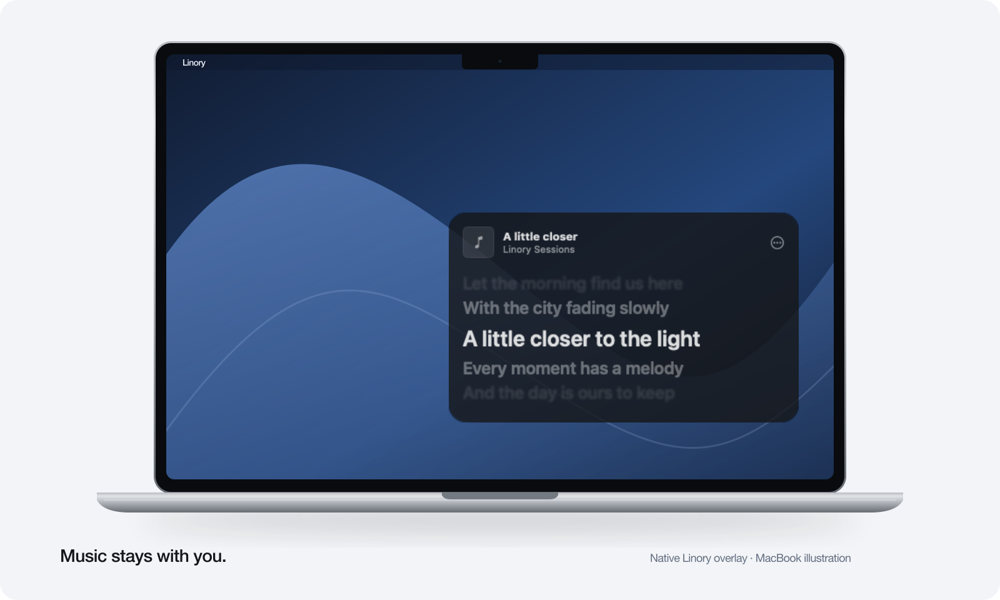
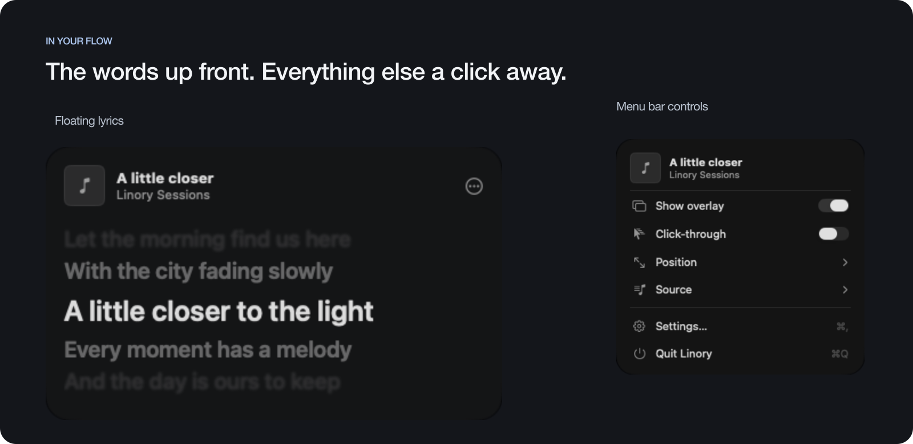
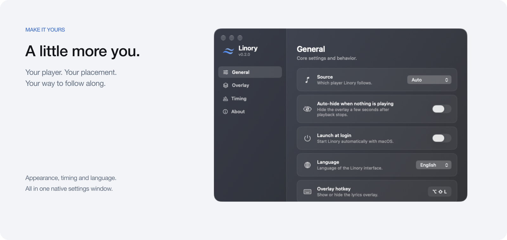

  <picture>
    <source media="(prefers-color-scheme: dark)" srcset="Branding/Linory_Horizontal_Dark.png">
    
  </picture>

<h1 align="center">Lyrics in your flow.</h1>

Floating synced lyrics for macOS. Keep the words in view. Stay with what you’re doing.

  <a href="https://github.com/MikeLeonFox/LyricsOverlay/releases"><b>Download for Mac ↗</b></a> &nbsp; · &nbsp;
  <a href="docs/USAGE.md">Getting started</a> &nbsp; · &nbsp;
  <a href="docs/DEVELOPMENT.md">Build from source</a>

macOS 13+ deployment target &nbsp; · &nbsp; Spotify &amp; Apple Music desktop apps &nbsp; · &nbsp; Early prototype

### Your music. Always in view.

Follow the current line as words brighten with playback. Keep the next lines nearby, without switching away from your work.

**Move it anywhere.** Drag the overlay or snap it to a corner. Enable click-through to keep working underneath, and show or hide it with **⌥ ⇧ L**.

**Follow your player.** Auto follows the app that’s playing. Choose Spotify or Apple Music whenever you prefer.

**Make room for your style.** Adjust type, size, opacity and lyric timing. Choose English or German, and optionally launch at login.

App views captured from the current SwiftUI implementation using original demo lyrics. The MacBook and desktop are illustrations. System materials vary with macOS and appearance. [About the visuals](Branding/README/VISUALS.md).

### Get Linory

Download the latest ZIP from [Releases](https://github.com/MikeLeonFox/LyricsOverlay/releases), extract it, and open `Linory.app`. Play a song and allow macOS Automation access to your player when prompted. No player login or API key is needed.

> [!IMPORTANT]
> **Early, unnotarized prototype.** This build has no Apple Developer ID signature and may be blocked by Gatekeeper. Only open it if you trust the source; follow [Apple’s opening instructions](https://support.apple.com/guide/mac-help/open-a-mac-app-from-an-unidentified-developer-mh40616/mac). Do not disable Gatekeeper globally. Tested on one Mac; Intel hardware and the full macOS 13+ deployment range remain unverified.

Lyrics come from [LRCLIB](https://lrclib.net/); availability and timing vary by song. Plain lyrics use estimated timing and are marked **~ not synced**. Uncached lookups send track metadata to LRCLIB; Spotify artwork is fetched separately. No application analytics are implemented. [Privacy and data](docs/PRIVACY.md).

  <a href="docs/USAGE.md">Usage &amp; troubleshooting</a> &nbsp; · &nbsp;
  <a href="docs/DEVELOPMENT.md">Development</a> &nbsp; · &nbsp;
  <a href="CONTRIBUTING.md">Contributing</a> &nbsp; · &nbsp;
  <a href="LICENSE">MIT license</a>

A <a href="https://varell.co">Varell</a> product. Built on <a href="https://github.com/JulianRudrich/LyricsOverlay">JulianRudrich/LyricsOverlay</a>. MIT applies to the code, not third-party lyrics. Not affiliated with Spotify, Apple or LRCLIB.

